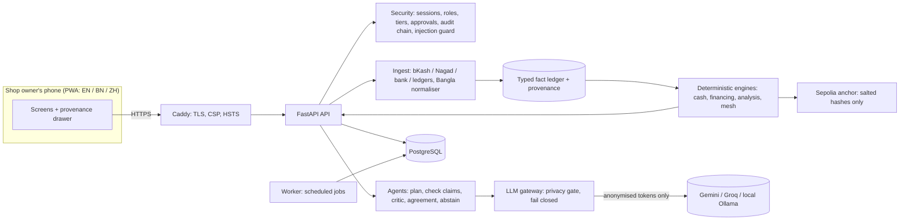

# Hishab — SME Finance Copilot

**2026 Shenzhen International FinTech Competition (FinTechathon), International Track, Topic E: SME Finance Copilot.**
Team Hishab, Bangladesh University of Professionals: Nobo Ishraque (lead), Amdad, Labib.

Hishab is a mobile-first copilot for a small Bangladeshi business: a grocery in Mirpur, a
pharmacy in Dhanmondi, a fabric wholesaler in Islampur. It reads the shop's own records (bKash,
Nagad and bank statements, cash book, baki register), warns before cash runs short, ranks real
financing options by their true yearly cost, and explains the business's numbers. **Code
computes every number; the model only explains it.** Every figure on screen can be clicked to
show its formula and the source rows behind it.

> Data notice: the demo runs on a deterministic **synthetic** universe of five invented Dhaka
> shops (`data/synthetic/`), labelled synthetic everywhere it appears. The financing catalogue
> (`data/public/financing/bd.yaml`) is real: each product row carries its source URL, a quoted
> line from the source and the date it was checked.

## What it does

| Area (Topic E) | What Hishab does | Where |
| --- | --- | --- |
| A. Financing-option matching | True yearly cost of every option, fees included (effective annual rate from the cash flows); eligibility with reasons, and "not on record" instead of guessing; ranking; non-loan options; draft application that only the owner can submit, with a step-up code | `backend/app/engines/financing/`, `backend/app/api/financing.py` |
| B. Cash-flow management with alerts | 13-week forecast band from seeded Monte Carlo paths, cash gaps, alerts in Watch / Warning / Critical tiers, what-if levers, cash buffer | `backend/app/engines/cash/`, `backend/app/api/cash.py` |
| C. Business financial analysis | Statements, ratios, expected vs reality, scenario comparison, decision stability score | `backend/app/engines/analysis/` |
| Engine room | Typed fact ledger with provenance; privacy tokens (only anonymised data leaves the server); permission tiers READ / SUGGEST / DRAFT / EXECUTE / DENY with owner approval and step-up for EXECUTE; hash-chained audit log; multilingual prompt-injection guard (English, Bangla, Banglish, Chinese) | `backend/app/facts/`, `backend/app/privacy/`, `backend/app/security/` |
| Liquidity mesh (on-chain) | Clears circular debt between shops with less cash (min-cost-flow netting), every party approves, salted SHA-256 commitments anchored on Ethereum Sepolia (hashes only, never names or amounts) | `backend/app/engines/mesh/`, `backend/app/chain/` |
| Copilot | Answers questions with decision cards: checked claims, a case against, model agreement, abstention when unsure | `backend/app/agents/`, `backend/app/llm/` (WP-10, being merged) |
| Web app | React PWA in English, বাংলা and 中文; provenance drawer on every number | `web/` |

Status of this snapshot (20 Oct 2026): see `docs/PLAN.md` §8. Cut for the submission and kept as
roadmap: market watch and negotiation (N3, N19), sending messages by email (drafts stay in the
approval queue), the nightly audit drill. See `docs/FEATURES.md`.

## Quick start

Prerequisites: Git, Node.js 22, [uv](https://docs.astral.sh/uv/) (uv installs Python 3.12).
The same commands work in Windows PowerShell, macOS and Linux.

```
npm run setup      # install backend (uv) and web (npm) dependencies
npm run test       # all backend + web unit tests, offline (no LLM, no network)
npm run dev        # API on http://localhost:8000, web on http://localhost:5173
npm run e2e        # browser tests (needs `npm run dev` running)
npm run lint       # ruff + eslint + tsc
```

Configuration: copy `backend/.env.example` to `backend/.env`. With no keys the app runs fully
offline: recorded model responses (`LLM_MODE=fixtures`) and an offline chain anchor
(`CHAIN_MODE=offline`). Variables: `APP_ENV`, `DEMO_MODE`, `DATABASE_URL`, `SECRET_KEY`,
`VAULT_KEY`, `GEMINI_API_KEY`, `GROQ_API_KEY`, `OLLAMA_BASE_URL`, `LLM_MODE`, `SEPOLIA_RPC_URL`,
`SEPOLIA_PRIVATE_KEY`, `CHAIN_MODE`, `SMTP_*`. Never commit `.env`.

**Demo accounts** exist only when `DEMO_MODE` is on and `APP_ENV` is not `production`. The
sign-in page lists them (`GET /api/auth/demo-accounts`): an owner, accountant, staff member,
lender viewer and compliance officer for the grocery, and an owner for each other shop. Owners
use a TOTP step-up code, which demo mode shows on screen.

## Architecture



Design rules that every module follows are in `CLAUDE.md`: no number shown to a user comes from a
language model; engines read typed facts, never free text; only anonymised data leaves the
server; every action has a permission tier and money never moves without a human; abstain
rather than guess.

## Repository layout

| Path | What |
| --- | --- |
| `backend/app/contracts/` | Frozen shared schemas (exported to `docs/api/contracts.json` and the web's types) |
| `backend/app/facts/` | Typed fact ledger, metric registry, provenance graph |
| `backend/app/ingest/` | Statement and ledger parsers, Bangla/Banglish normaliser, OCR drafts, preview and commit |
| `backend/app/privacy/` | PII detectors, token vault (HMAC + AES-256-GCM), anonymiser, fail-closed gate, shop-file anonymiser |
| `backend/app/engines/` | Deterministic engines: `cash/`, `financing/`, `analysis/`, `mesh/` |
| `backend/app/chain/` | Salted commitments and the Sepolia / offline anchorer |
| `backend/app/security/` | Auth, roles, permission tiers, approvals, audit chain, injection guard, web hardening |
| `backend/app/reports/` | Trust Passport, consented sharing, verification |
| `backend/app/api/` | One router per work package, mounted under `/api` |
| `web/` | React + TypeScript PWA |
| `data/synthetic/` | Deterministic synthetic universe (seed 20261020) |
| `data/public/` | Bangladesh financing catalogue with sources, festival calendar, injection corpus |
| `ml/` | Notebooks and model artefacts |
| `infra/` | Docker Compose, Caddy, deploy script |
| `docs/` | Plan, features, runbook, work packages, submission documents |

## Tests

- `npm run test` runs every backend (pytest) and web (Vitest) unit test. Tests never call a real
  model or the network; a guard in `backend/tests/conftest.py` fails any test that tries.
- Counts and the latest full run: `docs/submission/evidence/test-counts.md` and
  `docs/submission/evidence/test-runs/`.
- CI (`.github/workflows/ci.yml`) runs on every pull request and on `main`: ruff, pytest,
  pip-audit, eslint, tsc, Vitest, npm audit, a gitleaks secret scan, and a Docker stack boot
  (Postgres, API, worker, Caddy) with TLS and security-header smoke tests.

## Deployment

`docs/DEPLOY.md` sets up the stack from zero on a Linux server (Docker Compose behind Caddy with
automatic HTTPS). After CI passes on `main`, `.github/workflows/deploy.yml` ships the exact commit
to the server, rebuilds, runs an HTTPS health check, and rolls back if it fails. The hosted demo
runs in Singapore, and the web app loads no third-party hosts, so it stays reachable from mainland
China.

## Security

Permission tiers, the threat model, the OWASP LLM Top 10 mapping and an honest known-risk list are
in `docs/submission/security-self-assessment.md`.

## Submission documents

| Deliverable | File |
| --- | --- |
| 01 Technical documentation | `docs/submission/technical-documentation.md` |
| 02 Presentation deck | linked in the submission email |
| 03 Demo video | script in `docs/submission/video-script.md` |
| 04 Source code, README, deployment, tests | this repository, `docs/DEPLOY.md`, `npm run test` |
| 05 Security self-assessment | `docs/submission/security-self-assessment.md` |
| 06 Execution evidence | `docs/submission/evidence/` |
