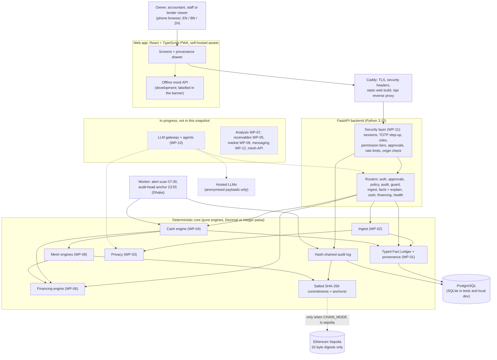

# Hishab: SME Finance Copilot. Technical documentation

**Deliverable 01: architecture, core algorithms, security design**

| | |
| --- | --- |
| Competition | 2026 Shenzhen International FinTech Competition (FinTechathon), International Track |
| Topic | **E: SME Finance Copilot** (financing-option matching, cash-flow management with alerts, business financial analysis) |
| Team | Hishab: Nobo Ishraque (lead), Amdad, Labib |
| University | Bangladesh University of Professionals (BUP), Dhaka, Bangladesh |
| Date | 19 Oct 2026 (insurance submission snapshot) |
| Code | branch `wp-19-submission` at commit `412c6f5` (same code as `main` at that commit) |

## How to read this document

Every part of the system has one of three labels:

- **Built**: merged, tested, and in this snapshot.
- **Partial**: some milestones merged; the gaps are named.
- **In progress, not in this snapshot**: designed and specified in `docs/packages/WP-*.md`,
  being built on a branch, not merged. We describe the design briefly and claim nothing about it.

Every number in this document comes from a file in the repository, and the source path is
written next to it. Worked examples were computed for this document by running the repository's
own engines on the synthetic data (commands in Appendix A). Test counts are not repeated here:
see `docs/submission/evidence/test-counts.md`, which `npm run evidence` regenerates.

**All business data in this snapshot is synthetic.** No real shop data, real users or live
LLM traces are included or claimed.

### Snapshot status

| Area | Work package | Status | Notes |
| --- | --- | --- | --- |
| Scaffold, 58 frozen contracts (v1.2.0), synthetic universe, CI | WP-00 | Built | `backend/app/contracts/`, `data/synthetic/` |
| Typed Fact Ledger, provenance, `/api/facts`, `/api/explain` | WP-01 | Built | |
| Ingestion: bKash, Nagad, bank, ledgers, Bangla normaliser, OCR drafts, preview/commit | WP-02 | Built | |
| Privacy: detectors, token vault, anonymiser, fail-closed gate, shop-file anonymiser | WP-03 | Built | Gate not yet called by any LLM path (no LLM path exists yet) |
| Cash engine: forecast, Monte Carlo, gaps, alerts, levers, buffer, backtest, API | WP-04 | Built | |
| Financing: true cost, catalogue, eligibility, ranking, lender score, API | WP-06 | Built | Fit term not wired into the API (see §3.4) |
| Liquidity mesh engines + Sepolia anchoring code | WP-08 | Partial (7/8) | No mesh API yet |
| Security: auth, roles, tiers, approvals, audit chain, injection guard, hardening | WP-11 | Built | |
| Trust Passport, sharing, state adapter | WP-13 | Partial (3/5) | Report and verify page API not built |
| Web app (12 milestones) | WP-14 | Built | Some screens run on the web's offline mock (see §2.3) |
| ML notebooks | WP-17 | Partial (2/4 in progress) | Injection classifier not deployed |
| Docker, Caddy, deploy with rollback, backups | WP-18 | Partial (4/6) | China checks and mirror pending |
| Analysis, P&L, scenarios, stability score | WP-07 | In progress, not in this snapshot | PR #24 |
| LLM gateway, agents, checker, critic, agreement, abstention | WP-10 | In progress, not in this snapshot | |
| Receivables, market watch, messaging, e2e, eval harness | WP-05, 09, 12, 15, 16 | In progress, not in this snapshot | |

Source: `docs/PLAN.md` §8 and the code on this branch.

---

## 1. Problem and design principles

A small Bangladeshi shop sells on credit (*baki*), takes most payments through bKash and Nagad,
keeps a paper ledger, and borrows informally because it cannot show a lender a clean record. The
owner needs three things from a copilot (Topic E): which financing to take and what it really
costs, when cash will run short and what to do about it, and an honest picture of the business.

The theme is *AI as a Financial Participant*. An agent that acts on money must be right about
numbers and must never act alone. Research summarised in `docs/CONTEXT.md` §4 shows why plain
LLMs fail here: they are not calculators, they retrieve the wrong figure, they cannot reliably
correct themselves, and their stated confidence is inflated. Hishab is built around five rules,
stated as non-negotiable in `CLAUDE.md`:

| # | Rule (from `CLAUDE.md`) | How the code enforces it |
| --- | --- | --- |
| 1 | **Code computes, the model narrates.** No number shown to a user may come from an LLM. | Every figure is a `Figure` contract with mandatory `Provenance` (`formula_id`, version, input fact ids, source rows, parameters): `backend/app/contracts/facts.py`. Money is `Decimal`; floats are refused by the `Money` validator (`backend/app/contracts/common.py`). |
| 2 | **Typed facts only.** Engines read the Typed Fact Ledger, never free text. | Engines are pure functions over frozen Pydantic contracts. Fact lookups are exact field-for-field matches; there is no fuzzy or vector lookup (`backend/app/facts/store.py`). |
| 3 | **Only anonymised data leaves the server.** | Detectors, token vault, anonymiser and a fail-closed gate (`backend/app/privacy/`). In this snapshot no code calls an LLM at all; the only optional outbound call is the Sepolia RPC, which carries a 32-byte hash. |
| 4 | **Every action has a permission tier** (READ, SUGGEST, DRAFT, EXECUTE, DENY). EXECUTE needs owner approval with a step-up code. Money never moves without a human. | One policy table (`backend/app/security/policy.py`); approvals with fresh TOTP, 24-hour expiry and a re-check at execution (`backend/app/security/approvals.py`). No executor that moves money exists. |
| 5 | **Prefer abstaining to guessing.** | Missing eligibility facts give `not_on_record`, never a pass (`engines/financing/eligibility.py`); the cash API answers 422 with what is missing when it has under 8 weeks of history (`api/cash.py`); residual-gap routing abstains when nothing is eligible (`engines/mesh/residual.py`). |

Two further rules shape the data: synthetic data is labelled `data_mode: "synthetic"` everywhere,
and when a figure mixes inputs, the most cautious label wins (`combined_data_mode` in
`backend/app/facts/provenance.py`).

---

## 2. Architecture

### 2.1 Components



Dashed boxes and arrows are not in this snapshot (or, for the mock, development only).

| Component | Path | Role |
| --- | --- | --- |
| Contracts | `backend/app/contracts/` | 58 frozen Pydantic models, version 1.2.0; unknown fields rejected; exported to `docs/api/contracts.json` and generated into `web/src/api/contracts.ts` (CI fails on drift) |
| App factory | `backend/app/main.py` | Discovers every `app/api/<name>.py` router and every `app/<area>/app_hooks.py`; CORS is added last so it is the outermost layer; interactive API docs only in development and test |
| Engines | `backend/app/engines/{cash,financing,mesh}/` | Pure functions: contracts in, contracts out; no database or network |
| Fact ledger | `backend/app/facts/` | Store, metric registry, provenance graph, masking hook |
| Ingest | `backend/app/ingest/` | File parsers, normaliser, OCR drafts, preview/commit |
| Privacy | `backend/app/privacy/` | Detectors, vault, anonymiser, gate, shop-file anonymiser |
| Security | `backend/app/security/` | Auth, roles, policy, approvals, audit, guard, web hardening |
| Chain | `backend/app/chain/` | Canonical salted commitments; offline and Sepolia anchorers |
| Reports | `backend/app/reports/` | Trust Passport, scoped sharing, verification, state adapter (partial) |
| Worker | `backend/app/worker.py` | Discovers `JOBS` in `app/**/jobs.py`; runs them on APScheduler cron (Asia/Dhaka) |
| Web | `web/src/` | 11 screens + public verify page, provenance drawer, EN/BN/ZH, PWA |

### 2.2 Data flow (one request, end to end)

1. **Ingest.** The owner uploads a bKash statement. `POST /api/ingest/preview` detects the format,
   normalises amounts and dates, clusters counterparties into opaque `PARTY_` tokens, flags
   duplicates and returns a preview with a keyed digest. Nothing is stored in the ledger yet.
2. **Commit.** `POST /api/ingest/commit` must name the same digest. Only confirmed draft rows
   (for example OCR lines) are committed. The tenant's ledger revision increases.
3. **Facts.** Ledger metrics (`closing_balance`, `dso`, ...) are computed by registered formulas
   and stored as `Fact` rows that cite their inputs and source rows. A figure computed against an
   older ledger revision is never served as current.
4. **Engines.** `GET /api/cash/alerts` runs the forecaster, the Monte Carlo, gap detection,
   alert tiers and levers. The levers call the financing engine (standby loan, early-pay check)
   and the mesh engine (netting). Each output number is a `Figure` recorded in the ledger.
5. **Explain.** Any number on screen opens `GET /api/explain/{figure_id}`: formula, inputs with
   values, and source rows, masked unless the caller holds `source_rows:read` for that tenant.
6. **Act.** An action card (for example "send the application to the lender") is EXECUTE tier.
   It goes to `POST /api/approvals`; the owner approves with a fresh TOTP code; execution
   re-checks the policy and the card's SHA-256. Every step is written to the audit chain.
7. **Anchor.** Nightly, the worker commits every tenant's audit-chain head to one digest and
   anchors it (Sepolia when configured, otherwise offline and labelled offline).

### 2.3 What the web app talks to

The web calls the API only through `web/src/api/client.ts`. `web/src/api/apiMode.ts` defines
three modes: `live` (real backend only; the production default), `mock` (offline fixtures in
`web/src/mocks`, always labelled in the banner) and `auto` (development default: real backend
first, mock only for routes whose router has not landed).

| Live backend in this snapshot | Mock only in this snapshot |
| --- | --- |
| Sign-in, TOTP, team and lender access, approvals inbox, audit verify | Receivables (WP-05) |
| Upload: preview, column mapping, commit (WP-02) | Analysis (WP-07) |
| Cash: forecast, gaps, alerts, what-if (WP-04) | Mesh screen and netting approval (WP-08 API) |
| Financing: match, lender check, application card (WP-06) | Market (WP-09), messages and settings (WP-12) |
| Provenance drawer (`/api/explain`) | Reports, passport sharing, verify page API (WP-13) |
| | Copilot panel, abstention log, audit drill (WP-10, WP-16) |

The mock-only screens show how the finished product is meant to work. They are not evidence of
backend functionality.

### 2.4 Deployment

- **Topology** (`infra/docker-compose.yml`): `db` (PostgreSQL 16), `api` (FastAPI), `worker`
  (same image, `python -m app.worker`), `web` (Caddy serving the built web app and proxying
  `/api/*` to the API). Secrets come from a server-only env file, never from git.
- **TLS and headers** (`infra/Caddyfile`): automatic Let's Encrypt certificate for
  `DEPLOY_DOMAIN`; HSTS, a strict CSP (`default-src 'self'`, no third-party origins),
  `X-Frame-Options: DENY`, `nosniff`, COOP, compression. The API adds its own headers too, so a
  request that bypasses Caddy is still covered (`backend/app/security/web.py`).
- **Continuous deployment** (`.github/workflows/deploy.yml`, `infra/remote-deploy.sh`): after CI
  passes on `main`, the exact commit is shipped, rebuilt, health-checked at `/api/health`, and
  rolled back to the previous release on failure. It skips until the server secrets exist.
  Hourly `pg_dump` backups keep 48 copies (`infra/backup.sh`).
- **Location.** The target host is one server in Singapore (decision D6 in `docs/PLAN.md`: the
  Gemini API is not served in Hong Kong or mainland China but is in Singapore). Domain:
  `hishab.quadbits.net`.
- **China reachability by design.** No Google Fonts, CDNs or analytics: fonts and assets are
  bundled (`docs/packages/WP-14.md`). Swagger UI, which loads from a CDN, is disabled outside
  development (`backend/app/main.py`). A Playwright test fails if the home page contacts any
  host other than its own (`web/e2e/smoke.spec.ts`). Measurements from mainland nodes are WP-18
  milestone 4 and are **pending** in this snapshot.

---

## 3. Core algorithms

### 3.1 Typed Fact Ledger and provenance (Built)

Files: `backend/app/facts/{store,registry,provenance,masking}.py`.

- **Fact.** `{id, tenant_id, metric, value: Decimal, unit, period, entity_token, provenance,
  source_refs, data_mode}`. A lookup `(tenant, metric, period, entity)` must match exactly: a
  metric name differing in case, or a period one day off, is a miss, never a near match.
- **Metric registry.** 17 named, versioned definitions, each with a `formula_id`, a
  human-readable expression and a pure function: `cash_in`, `cash_out`, `cash_sales`,
  `credit_sales`, `credit_purchases`, `purchases`, `operating_expenses`, `receivables`,
  `payables`, `opening_balance`, `net_sales`, `net_cash_flow`, `closing_balance`,
  `gross_profit`, `gross_margin`, `dso`, `dpo`. A released definition never changes; a new rule
  is a new version, so old figures still explain themselves with the old expression. DSO and
  DPO are on a credit basis (`dso = receivables / credit_sales x days_in_period`) because cash
  sales never wait.
- **Provenance graph.** `compute()` stores each result with the closure of inputs underneath it,
  cited as `txn:<id>`, `inv:<id>`, `bill:<id>` or `fact:<id>`. Engines outside WP-01 record
  their own figures with `record_computed()` / `record_figure()`. The cash API records every
  figure it returns, with the `closing_balance` fact as its cited input
  (`backend/app/api/cash.py`, class `Recorder`).
- **Staleness.** Every change to a tenant's ledger bumps a revision. Computed facts record the
  revision they were confirmed against, so a figure that may predate newer rows is recomputed
  (or reported stale), never served as current.
- **Masking.** Source rows pass through one masking hook for every caller. The installed policy
  (`backend/app/security/roles.py`, `policy_masker`) shows rows only to a same-tenant caller
  holding `source_rows:read`; others get keyed, non-reversible references.

### 3.2 Ingestion (Built)

Files: `backend/app/ingest/`.

- **Formats:** bKash and Nagad statements, generic bank CSV, ledger CSV/XLSX with a column
  mapping step, ledger photos. Detection matches header names (English, Bangla, Banglish)
  exactly after normalisation; preamble lines above the table are skipped (`formats.py`).
- **Normaliser** (`normalise.py`): Bangla digits, Tk/৳/BDT/টাকা markers, lakh grouping and
  লাখ/কোটি/হাজার words, month names in three scripts, Bengali calendar dates, day/month order
  decided per file by evidence. A value that cannot be read with certainty raises an error with
  a reason key and becomes an unparsed row or a draft, never a guess.
- **OCR** (`ocr.py`): local Tesseract with `ben+eng`; the photo never leaves the server. Each
  line becomes a draft with a confidence; low-confidence drafts are flagged and never committed
  without the owner ticking them.
- **Preview/commit** (`preview.py`): the preview stores an HMAC-SHA256 of the uploaded bytes
  (key derived from the server secret, bound to the tenant). The commit must present the same
  digest. Duplicates are checked at preview and again at commit. Uploads are capped at 10 MB;
  previews expire after 24 hours.

### 3.3 Cash engine: forecast, Monte Carlo, gaps, alerts, levers (Built)

Files: `backend/app/engines/cash/`. API: `backend/app/api/cash.py`. Feature spec: FEATURES Q1, Q3.

**Baseline forecast** (`baseline.py`, `sales.py`, `delays.py`). For each of the next 91 days:

```
balance(day) = opening balance + expected inflows - expected outflows

sales(day)        = level x weekday factor x month-end factor x festival factor
collections       = sum over open invoices of owed x P(customer pays on that day)
new credit sales  = recent credit-sales rate x share of invoices paid within n days of issue
outflows          = recurring obligations on their schedule
                  + open bills on the day this business usually pays that supplier
                  + new bills, cash purchases and running costs at their recent daily rate
```

All factors are estimated from the shop's own history up to the forecast date only: weekday and
month-end factors from the last 26 weeks, the level from the last 8 weeks, festival factors
(Eid-ul-Fitr, Eid-ul-Adha, Pohela Boishakh; `data/public/calendar/bd_festivals.yaml`) from earlier
occurrences, with a run-up of 10 days and 3 days after. A factor without evidence stays at 1.
Payment delays are each customer's own `paid date - due date` history (the tenant-wide
distribution when a customer has fewer than 3 settled invoices), conditioned on the invoice
still being unpaid today. If no observed delay is left, the invoice contributes nothing: the
forecast prefers under-counting cash to inventing it. Disputed invoices are not expected.

Why not the ML delay model: on a time split of the synthetic data, LightGBM scored MAE 2.92 days
against 2.83 for the per-customer history, and the decision rule required a 5% improvement
(source: `ml/artifacts/payment_delay_metrics.json`).

**Monte Carlo** (`simulate.py`). 1,000 paths, seed 20261020, NumPy PCG64, amounts in integer
paisa and ratios in integer basis points, so every band is exact and reproducible:

- sales noise: the shop's own observed/expected ratios on past plain days, resampled in
  28-day circular blocks (a slow fortnight stays slow);
- collections: one lateness draw per customer per path, applied to all of that customer's
  invoices (a slow payer is slow everywhere);
- costs and new bills: past days' actual spending replayed in 28-day blocks, so one-off shocks
  recur as often and as large as they did;
- obligations and open bills: certain.

Percentiles are nearest-rank order statistics (P10 = the 100th lowest of 1,000), so
`P10 <= P50 <= P90` holds by construction. A what-if or a lever replays the **same draws**
(common random numbers): the difference between two runs is the change, never luck.

**Buffer target** (`buffer.py`): the 95th percentile, over paths, of the deepest dip below the
likely (P50) line. Keeping P50 at or above it keeps the shop out of the red in 19 of 20 paths.

**Gaps** (`gaps.py`): a *risk day* has more than 5% of paths below the buffer; a *gap* is a run
of risk days in which more than 20% of paths dip. For each gap the engine reports the first
breach, the worst day, the probability (paths below the buffer on at least one gap day),
the expected shortfall `mean over paths of max(0, buffer - lowest balance in the gap)`, the lead
time and the three largest drivers in Tk (bills, obligations, late customers, sales below norm).
Five leading indicators fire from the ledger before any crossing: DSO rising, a top customer
slowing, stock building, sales below the seasonal norm, payroll or EMI at risk.

**Alert tiers** (`alerts.py`), exactly as FEATURES Q1. "P within a-b" = share of paths below the
buffer on at least one gap day between day a and day b:

| Tier | Trigger (any one) | Delivery |
| --- | --- | --- |
| Critical | P within 1-7 > 20%; P within 1-21 > 60%; a salary or EMI day in the gap with P50 < 0 | in-app + email, pinned on Today |
| Warning | P within 8-21 > 20%; P within 22-45 > 50% | in-app + email |
| Watch | P within 22-90 > 20% | in-app + weekly digest |

Alert fatigue: a repeat is sent only if it escalates, or the forecast moved by more than 3 days
or 10% of the shortfall, and never inside the cooldown (24 h Critical, 3 days Warning, 7 days
Watch). Email delivery belongs to WP-12 and is not built; the daily scan job records deliveries.

**Levers** (`levers.py`). Each lever is a scenario replayed on the gap's own draws; its effect is
`shortfall without - shortfall with` on the same paths. Only levers that reduce the gap are
offered, ranked cheapest first: re-time a payable within terms, stagger a purchase week, ask for
an advance, offer a 2% early-pay discount (only if its annualised cost is below the cheapest
eligible loan), net circular debt through the mesh, or arrange a standby loan (WP-06 ranking,
sized to cover the gap in 19 of 20 paths). Each becomes an action card with its policy tier.

**Abstention.** With fewer than 8 weeks of transactions, or no opening balance on record, the
cash API answers 422 with an `ApiError` naming what is missing (`api/cash.py`, `MIN_HISTORY_DAYS = 56`).

**Worked example** (synthetic grocery shop `sme_grocery`, as of 2026-09-30; computed for this
document with the repo's engines, see Appendix A):

| Quantity | Value |
| --- | --- |
| Opening balance | Tk 427,842.00 |
| Buffer target (P95 dip) | Tk 296,481.07 |
| Band on 2026-12-30 (day 91): P10 / P50 / P90 | Tk 379,696.79 / 511,060.52 / 638,980.00 |
| Plain forecast | no gap; runway = full 91-day horizon |
| What-if: sales -10%, every customer pays 7 days later (same draws) | 4 gaps |
| First gap: days 4-13, first breach day 10 | P = 0.2720, expected shortfall Tk 11,901.90, tier **Warning** (P within 8-21 > 20%) |
| Its top drivers | two supplier bills of Tk 82,618.00 each, an obligation of Tk 35,000.00 |
| Best lever: stagger a purchase week | cost Tk 0, shortfall reduced by Tk 7,602.01, P after = 0.0960, EXECUTE card |
| Standby loan lever | cost Tk 2,697.69, shortfall reduced by Tk 4,455.14, DRAFT card |
| Last gap: days 29-91 | P = 0.9770, expected shortfall Tk 159,197.94, tier Warning (P within 22-45 > 50%) |

**Backtest** (`backtest.py`, FEATURES N15). Walk-forward: at each origin (every 14 days) the
forecaster sees only what was known that day, forecasts 91 days with 1,000 paths, and is scored
against what happened. Results on the **synthetic** shops (source: `docs/packages/WP-04.md`;
re-run for this document with `python -m app.engines.cash.backtest --sme <id>`, identical
output; the last two columns are from that re-run):

| SME (synthetic) | MAPE wk 1 ours / naive | MAPE 13 wks ours / naive | P10-P90 coverage | gap episodes | hit rate | median lead | alerting gaps / did not happen |
| --- | --- | --- | --- | --- | --- | --- | --- |
| grocery | 9.6% / 15.6% | 22.4% / 20.7% | 77% | 5 | 100% | 76 d | 50 / 34 |
| pharmacy | 7.9% / 15.5% | 16.3% / 17.9% | 81% | 7 | 100% | 75 d | 44 / 27 |
| fabric | 9.7% / 21.6% | 33.7% / 31.0% | 73% | 24 | 100% | 84 d | 38 / 10 |
| garment | 23.2% / 41.2% | 30.5% / 51.8% | 61% | 10 | 90% | 81 d | 28 / 0 |
| hardware | 7.9% / 18.7% | 15.4% / 24.0% | 83% | 8 | 100% | 87 d | 52 / 32 |

Reading: the forecast beats "balance stays the same" in week 1 for every shop, which is the
alert window. It loses over 13 weeks at the grocery and fabric shops. Alerts are over-cautious
at three shops: many alerting gaps did not happen. These are synthetic shops generated by our
own code, so this checks the harness, not real-world accuracy. The real-data backtest
(`ml/notebooks/01_forecast_backtest.py`, UCI Online Retail II) has not produced results yet.

### 3.4 Financing: true cost, eligibility, ranking, lender check (Built)

Files: `backend/app/engines/financing/`. API: `backend/app/api/financing.py`.

**True cost** (`cost.py`). Every option becomes dated cash flows from the borrower's side:

```
day 0      + principal - upfront fees - compulsory deposit
later      - instalments, periodic fees, maturity fees; + deposit returned at maturity

EAR = the r that solves   sum_i  cf_i / (1 + r)^(day_i / 365)  =  0
```

The rate is found by bisection in `Decimal` at 34 digits of precision (bracket doubled until the
present value turns positive, then up to 200 halvings to a width of 1e-12). Bisection is slower
than Newton's method but always converges and is deterministic. Rate conventions as Bangladeshi
lenders publish them: reducing balance (EMI), flat (interest on the original principal), daily
debit (flat interest repaid in equal daily debits, as nano loans do), discount (interest taken up
front) and none (owner top-up, netting). The early-pay discount used by levers is annualised as
`(1 / (1 - d))^(365 / days_early) - 1`.

**Worked example: Tk 50,000 for 180 days** (computed with `true_cost()` on rows of
`data/public/financing/bd.yaml`):

| Product (catalogue id) | Published rate (basis) | Structure, fees | EAR | Total cost |
| --- | --- | --- | --- | --- |
| Bangladesh Bank CMSME WC refinance (`bd-bb-cmsme-wc-refinance-2026`) | 9.00% (regulatory cap) | reducing, 0.5% upfront | 11.29% | Tk 1,570.67 |
| bKash digital loan, City Bank (`bd-citybank-bkash-loan`) | 9.00% (last published) | daily debit, 0.575% upfront | 22.15% | Tk 2,506.68 |
| Prime Chalti, Prime Bank (`bd-primebank-chalti`) | 15.00% (rate-sheet upper) | reducing, 0.5% upfront | 18.11% | Tk 2,460.14 |
| PKSF microenterprise (`bd-pksf-microenterprise`) | 24.00% (MRA cap) | reducing, no fee | 26.82% | Tk 3,557.74 |

The same 9% headline rate costs 11.29% a year as a reducing-balance loan and 22.15% as a
daily-debit loan, because daily repayment halves the average balance while interest is charged
on the full principal. Likewise a "2% off if paid 10 days early" discount costs 109.05% a year,
and 2% for 30 days costs 27.86% (`early_pay_discount_cost`), which is why levers offer a discount
only when it is cheaper than borrowing.

**Eligibility** (`eligibility.py`). Each published rule (for example `business_age_months >= 36`,
`trade_licence exists`) returns `pass`, `fail` or **`not_on_record`** when the fact is missing.
A missing fact never passes. Amount, tenor and purpose limits can only fail. Overall status:
any fail is fail; else any missing is `not_on_record`; else pass. The engine also lists exactly
which facts the owner could add (`missing_facts`). In the synthetic profiles, `bkash_account_active`,
`no_default_record`, `owner_is_woman`, `enterprise_closed` and `collateral_available` are not on
record, so products that need them come back `not_on_record` (`docs/packages/WP-01.md`, Questions).

**Repayment fit** (`fit.py`). Given WP-04's band, each day's balance is approximated as normal
with mean P50 and spread `(P90 - P10) / 2.5631`; the option's cumulative cash flows are added,
and the highest daily probability of falling below the buffer is reported. This is a lower bound
on the chance of any breach and is labelled an approximation.

**Ranking** (`ranking.py`). Score 0-100:

```
score = 0.45 cost + 0.25 fit + 0.15 approval + 0.10 speed + 0.05 lender
cost     = max(0, 100 - 2.5 x EAR%)          (4% scores 90; 40% or more scores 0)
fit      = 100 x (1 - P(balance < buffer))
approval = 100 x heuristic by product kind, x 0.6 if facts are missing, x 0.5 if collateral is needed and not on record
speed    = max(0, 100 - 3 x typical days to cash)
lender   = lender score (60 with no track record)
```

Ineligible options stay in the list with their reasons but score 0 and always rank below every
option that might work. Ties break on lower EAR, then product id, so the order is deterministic.
The approval and speed tables are documented assumptions shown to users, not lender data.

**Lender check** (`lenders.py`, FEATURES N20). From verified track-record events:

```
score = 100 - 50 x (hidden-fee incidents / n) - 30 x (disputes / n)
            - 4 x max(0, mean(realised EAR - quoted EAR)) - 15 if licence unknown
score = 0 if the licence is not found or revoked;   score = 60 with no events (cold start)
```

**Application card** (`application.py`). The best passing option becomes a
`submit_loan_application` card: EXECUTE tier, owner approval with step-up, 24-hour expiry. Its
payload holds only facts we have, the facts still missing, the EAR, the rate basis and the
source URL. Drafting (`draft_loan_application`) is DRAFT tier.

**What the API does not do yet** (stated in `backend/app/api/financing.py`): the WP-04 band is
not passed in, so every option carries `fit.no_forecast`; no lender has a stored track record;
no licence registry is loaded, so licence status is `unknown`. The non-loan options in
`nonloan.py` (owner top-up, supplier term extension, buyer early pay, mesh netting) are priced by
the same engine but reach users through the cash levers, not through `/financing/match`.

### 3.5 Liquidity mesh: netting, consent, settlement, routing, attestations (Partial: engines built, no API)

Files: `backend/app/engines/mesh/`. Feature spec: FEATURES N14, Q4.

**Graph** (`graph.py`). Only open BDT obligations between two opted-in tenants enter a directed
graph, debtor to creditor, amounts in integer paisa. Groups with circular debt are the strongly
connected components of size 2 or more.

**Netting by minimum-cost flow** (`netting.py`). For each group:

```
node demand(t) = sum owed to t - sum t owes          (net position; > 0 receives)
edge d -> c    = capacity: what d owes c;  cost 1 per paisa
minimise total cash moved, subject to every node meeting its demand    (networkx.min_cost_flow)
```

The original debts are themselves a feasible flow, so a solution always exists; the optimum is
the original minus the largest circulation that can be cancelled. Settlements run only along
existing debts, so nobody pays a firm it never owed. An opt-in mode (`allow_new_links`) lets any
net debtor pay any net creditor and reaches the theoretical minimum, the sum of positive net
positions. Invariants, property-tested with Hypothesis on random graphs in
`backend/tests/mesh/test_netting.py`: every net position is unchanged; along debts, no edge
carries more than was owed; with new links, nobody pays more than their total debt; net total
never exceeds gross; no payment cycle is left.

**Worked example: the synthetic demo ring** (`data/synthetic/universe/mesh_obligations.csv`;
computed with `build_graph` and `propose_rounds`):

| Obligation | Debtor -> creditor | Amount |
| --- | --- | --- |
| RING-FG-001 | garment -> fabric | Tk 450,000.00 |
| RING-GH-001 | hardware -> garment | Tk 320,000.00 |
| RING-HF-001 | fabric -> hardware | Tk 380,000.00 |
| **Gross circular debt** | | **Tk 1,150,000.00** |
| Net positions | fabric +70,000; hardware +60,000; garment -130,000 | |
| Netting along debts | garment pays fabric 130,000; fabric pays hardware 60,000 | **Tk 190,000.00 cash** |
| Netting with new links | garment pays fabric 70,000 and hardware 60,000 | **Tk 130,000.00 cash** |

Every net position is the same after either settlement (checked in the run).

**Consent** (`consent.py`). Approving a round is EXECUTE tier: every participant must approve with
a verified step-up code; one rejection voids the round; a repeated approval is a no-op; rounds
expire after 48 hours.

**Settlement** (`settlement.py`). Only an approved, unexpired round whose obligations are all
still open settles. Each participant gets a receipt: what it pays and receives, which obligations
were discharged, and `cash saved = debts cleared - cash paid`. The settled record is then sealed
and anchored (§3.6). Moving money between SMEs can count as lending or deposit-taking, so real
funding is meant to route through licensed lenders (`docs/CONTEXT.md` §3); no money moves in
this snapshot.

**Residual-gap routing** (`residual.py`). After netting, a participant may still owe more cash
than it has: `gap = max(0, cash_out - cash on hand)`. Cash on hand comes from the fact ledger; a
tenant without that fact is treated as having none (fail closed). The gap is priced with the
WP-06 engine for the exact amount and bridge tenor; ineligible products are dropped and the
lowest **total taka cost** wins (ties: EAR, then WP-06 rank). If the cheapest is not WP-06's top
balanced rank, it is flagged `cheaper_than_top_ranked`. With nothing eligible, the router
abstains (`mesh.residual.no_eligible_option`) and the round cannot settle for that participant
until the owner decides.

**Counterparty attestations** (`attestations.py`, FEATURES Q4). Debtor and creditor each sign the
SHA-256 commitment of the same obligation record (who owes whom, how much, by when). The record is
**peer-verified** only if both parties confirmed that exact digest and nobody filed a dispute.
Attestation digests use a fixed public salt so either side can recompute them.

**Lender events** (`lender_events.py`). A loan becomes a track-record event for the lender check
only when it is fully repaid and every repayment obligation is peer-verified. Then
`realised APR` = the EAR (same bisection, §3.4) of the cash actually received and repaid;
`hidden fee` = the borrower received more than Tk 1 less than principal minus disclosed fees;
a dispute counts against the lender without using the contested amounts. Unverified loans are
skipped with a reason: no record is better than an unverified one.

### 3.6 Tamper evidence: salted commitments and Sepolia anchoring (Partial)

Files: `backend/app/chain/{digest,anchor}.py`.

```
digest = SHA-256( "hishab:v1:" + kind + ":" + salt + ":" + canonical JSON )
canonical JSON = sorted keys, no spaces, decimals as strings;   salt = 32 random bytes (hex)
```

The salt stays off-chain with the record. Without it, nobody can brute-force small amounts or
party names from a public hash. Only the 32-byte digest goes on chain: the Sepolia anchorer sends
a zero-value self-transfer whose data field is exactly the digest (chain id 11155111), and
`payload_for()` refuses anything that is not a 64-character lowercase hex digest. Verification
recomputes the digest from the record and salt, reads the transaction's data field, and reports
which of four checks failed (not anchored, not found on chain, receipt differs from chain, record
changed after anchoring). The same mechanism seals netting rounds, Trust Passport versions
(`backend/app/reports/passport.py`) and the daily audit-chain heads.

What runs today: the daily job `security.anchor_audit_heads` (23:55 Dhaka) anchors through
`SepoliaAnchorer` when `CHAIN_MODE=sepolia` and an RPC URL and key are configured, otherwise
through `OfflineAnchorer`, labelled `offline`. Netting rounds and passports are sealed by engine
functions that no API calls yet. Tests use a fake web3 object and never touch a node
(`backend/tests/mesh/test_sepolia.py`). **No Sepolia transaction hash is recorded in this
snapshot.**

### 3.7 Privacy pipeline (Built; not yet on an LLM path)

Files: `backend/app/privacy/`. Feature spec: FEATURES N6, N18, P11.

1. **Detect** (`detectors.py`): Bangladesh mobile numbers (bKash and Nagad accounts are mobile
   numbers), NID, payment cards (Luhn), long account numbers, emails, Dhaka addresses and area
   names, person and shop names from the party registry and a name list. Bangla digits are
   recognised everywhere. Fail closed: any standalone run of 10 or more digits that is not a
   phone number is treated as sensitive.
2. **Tokenise** (`vault.py`): `PERSON_xxxxxxxxxx = HMAC-SHA256(tenant | kind | normalised value)`,
   truncated, so tokens are stable inside a tenant and different across tenants. Originals are
   stored with AES-256-GCM (random 96-bit nonce; tenant and token as associated data, so a
   ciphertext copied elsewhere fails to decrypt). HMAC and encryption keys are derived separately
   from `VAULT_KEY` with HKDF. Restoring an original needs an authoriser; the default refuses everyone.
3. **Anonymise** (`anonymiser.py`): tokens become neutral labels in order of appearance
   ("Customer 1", "Firm A"); dates become relative ("month t-2"); place names and rare product
   terms become `[place]` / `[item]` (a memorisation guard); optionally amounts are multiplied by
   a secret factor so ratios survive and scale does not (P11). `restore()` maps labels back to
   tokens. Numbers in a model's answer are never restored or trusted.
4. **Gate** (`gate.py`): `assert_safe(payload)` runs every detector on the serialised payload and
   raises if any fires. The error names only kinds and counts, never values.

The WP-10 gateway is required to call `anonymise` then `assert_safe` on every request
(`docs/packages/WP-03.md`). That gateway is not in this snapshot. For field data (WP-20) the
shop-file anonymiser (`python -m app.privacy.shopfiles`) tokenises CSV/XLSX columns, refuses any
file with leftovers, and writes a counts-only report.

### 3.8 Agents and the LLM layer (In progress, not in this snapshot)

Design (`docs/packages/WP-10.md`, `docs/PLAN.md` §6): one OpenAI-compatible gateway with Gemini
Flash as the planner, Groq-hosted models as voters and critic, Ollama for a private local mode,
and an always-available deterministic planner. Every payload passes the privacy gate. The
composer emits each number as `Claim{text, value, formula_id, inputs}`; a checker recomputes it
from the fact ledger and drops mismatches; a critic from a different model family argues the case
against; models vote on judgement calls above a stakes threshold, and the agreement rate is the
confidence; the agent abstains when agreement, data or verification is short, naming what is
missing. The contracts for these objects already exist (`backend/app/contracts/agents.py`).
None of this runs in this snapshot, and no LLM output appears anywhere in it.

### 3.9 Other engines (In progress, not in this snapshot)

- **Analysis** (WP-07, PR #24): cash-basis P&L, ratios with provenance, expected-vs-actual
  variance, multi-variable scenarios, and a decision stability score (re-run each recommendation
  under economic stress, where advice may change, and irrelevant noise, where it must not).
- **Receivables** (WP-05): aging, explainable risk score, credit limits, reminder ladder, disputes.
- **Market watch and negotiation** (WP-09), **messaging and approval queue** (WP-12).
- **Evaluation harness** (WP-16): `npm run eval` is a placeholder that runs no tasks
  (`backend/eval/run.py`).

---

## 4. Security design (summary)

The full self-assessment, with the generated tier table, STRIDE threat model, OWASP Top 10 for
LLM Applications mapping and the known-risk list, is `docs/submission/security-self-assessment.md`.
This section summarises the design. All of it is in `backend/app/security/` and is Built.

| Control | Design | Code |
| --- | --- | --- |
| Permission tiers | One table decides (a) the tier each action needs and (b) how far each role may take it. EXECUTE = an owner approved this exact card with a fresh TOTP code, under 24 hours ago, and the policy still allows it at execution. A card's own tier can raise the requirement, never lower it, so model-written cards cannot talk their way down. | `policy.py` |
| DENY list | `change_bank_details`, `add_payee`, `disable_audit`, `export_raw_pii`: refused for every role, including the owner; no executor can be registered for them. | `policy.py`, `approvals.py` |
| Approvals | Idempotency keys on request and execution; the approved card's SHA-256 is stored and re-checked; policy re-checked at execution. No executor is registered in this snapshot, so an executed card is recorded in the audit chain and nothing is sent and no money moves. | `approvals.py` |
| Roles | owner, accountant, staff, lender_viewer, compliance. Lender access exists only through the owner's recorded consent: named lender, purpose, scopes, at most 30 days, revocable, created with step-up. | `roles.py`, `team.py` |
| Authentication | argon2id passwords; RFC 6238 TOTP, single-use per step; server-side sessions in HttpOnly SameSite=Strict cookies, 30-minute idle and 12-hour absolute limits; 5 failures in 15 minutes lock for 15 minutes. Demo accounts only in demo mode; production refuses demo mode. | `passwords.py`, `totp.py`, `sessions.py`, `lockout.py` |
| Audit chain | Per-tenant SHA-256 hash chain; ORM and database triggers refuse UPDATE and DELETE; verification finds the first bad link; daily heads anchored (§3.6). Details hold ids, counts and digests only. | `audit.py`, `jobs.py` |
| Injection guard | Rules for English, Bangla, Banglish and Chinese on normalised text (NFKC, case folding, zero-width and bidi controls removed, look-alike letters folded). Hits are quarantined server-side and only their SHA-256 is audited. A classifier slot exists; no classifier is installed (§7). | `guard.py`, `guard_rules.py` |
| Web hardening | CSP, HSTS, nosniff, frame denial, referrer and permissions policies, no-store on API data; per-route token-bucket rate limits; Origin check on state-changing requests; explicit CORS origins (wildcard refused when deployed). | `web.py` |
| Tenant isolation | Every query is scoped to the principal's tenant; other tenants' records answer 404; a `tenant_id` in a request must match the principal. | `deps.py`, routers |
| Secrets | Keys only in server env files and CI secrets; `.env` is git-ignored; gitleaks scans the tested commit's full history in CI. | `.github/workflows/ci.yml` |

---

## 5. Data

### 5.1 Synthetic SME universe (labelled synthetic)

`data/synthetic/generate.py` (seed 20261020, deterministic: same seed, same bytes; file hashes in
`data/synthetic/universe/manifest.json`) generates five Dhaka SMEs with 18 months of daily data,
2025-04-01 to 2026-09-30 (as-of date 2026-09-30):

| SME id | Display name (fictional) | Sector |
| --- | --- | --- |
| `sme_grocery` | Mirpur Mudi Store | grocery |
| `sme_pharmacy` | Dhanmondi Care Pharmacy | pharmacy |
| `sme_fabric` | Islampur Fabric House | fabric wholesale |
| `sme_garment` | Ashulia Stitch Works | garment subcontractor |
| `sme_hardware` | Nawabpur Hardware Traders | hardware |

Source: `data/synthetic/universe/<sme>/profile.json`. Each shop has raw files in the formats a
real shop would export (bKash, Nagad, bank statement, cash book, baki register, bills register,
obligations) plus `transactions_truth.csv` as typed ground truth, so the ingest parsers are
tested on realistic files. The data has weekday, month-end and festival seasonality, credit sales
with per-customer delay habits, recurring rent, salary and EMIs, and the three-firm debt ring of
§3.5. Every row carries `data_mode = synthetic`, and the web shows a synthetic-data banner in demo
mode. Real anonymised shop data (WP-20) is not in this snapshot (`data/real_anonymised/` does not exist).

### 5.2 Bangladesh financing catalogue (public, sourced)

`data/public/financing/bd.yaml` holds 13 priced products and 5 unpriced ones (counted with
`load_catalogue()` and `load_unpriced()`). Every row was checked on 2026-10-18 and carries a
`source_url` and a verbatim `evidence_quote`; the loader rejects unknown fields. Each rate has a
`rate_basis`: `published`, `rate_sheet_upper` (upper bound of a published range),
`regulatory_cap` (for example the Microcredit Regulatory Authority's 24% cap) or
`last_published`. The UI shows the basis next to every rate. Assumptions are stated in the file
header (reducing balance unless stated; Bangladesh Bank's 0.5% processing-fee ceiling applied
without its Tk cap; trade licence assumed where a page lists no eligibility, labelled "typical").

Products whose provider publishes no rate (for example invoice financing, factoring and two
bKash-channel loans) are listed under `unpriced` and shown as "ask the lender". **They are never
ranked on a guessed cost.** Regulatory facts behind the catalogue, with quotes, are in
`data/public/financing/bd_regulatory.yaml`. A second catalogue, `cn.yaml`, holds 3 products
modelled on Chinese digital SME credit (P14). They are illustrative, labelled `is_modelled: true`
and shown as "modelled"; they show the engine is portable, not real offers.

### 5.3 Other data

- Festival calendar: `data/public/calendar/bd_festivals.yaml` (Eid dates are +/- 1 day).
- Injection corpus: `data/public/injection/injection_corpus.jsonl`, 192 synthetic rows (96 attack,
  96 benign) in four languages, built by `data/public/injection/build.py`.

---

## 6. Testing and CI

**Counts:** see `docs/submission/evidence/test-counts.md` (regenerated by `npm run evidence`).

| Layer | Tool | Where |
| --- | --- | --- |
| Unit and parametrised scenario tables | pytest | `backend/tests/<area>/` |
| Property-based invariants | Hypothesis (derandomised in CI, `HYPOTHESIS_PROFILE=ci`) | netting invariants, graph, EAR, eligibility, fit and lender score, Monte Carlo, levers, provenance, dedupe, anonymiser round-trip, vault, contracts |
| Contract drift | pytest + CI step | JSON Schema vs `docs/api/contracts.json`; generated `web/src/api/contracts.ts` must not change on regeneration |
| Web units, i18n completeness, accessibility | Vitest, axe | `web/src/**/*.test.tsx` |
| End-to-end | Playwright | `web/e2e/smoke.spec.ts` (2 smoke tests; the full journey suite, WP-15, is not built) |

**Offline rule.** Tests never call real LLMs or the network: a session-wide fixture in
`backend/tests/conftest.py` makes any non-loopback socket connection fail the test. The Sepolia
anchorer is tested against a fake web3 object. The live OCR test runs only where Tesseract
`ben+eng` is installed (the API image), and is skipped in CI.

**CI** (`.github/workflows/ci.yml`, on `main` and every pull request):

1. Backend: ruff, pytest, `pip-audit --strict` on the locked dependencies.
2. Web: ESLint and TypeScript, contracts in sync, Vitest, `npm audit --audit-level=high`, build.
3. Secrets: gitleaks over the full history of the commit under test (an all-refs scan is planned
   before the repository is made public).
4. Docker stack: build all images, boot the Compose stack, then smoke-test through Caddy: TLS,
   `/api/health` reporting PostgreSQL, SPA fallback, CSP, HSTS and `X-Frame-Options` headers,
   HTTP to HTTPS redirect.

Not yet in CI: mutation testing and the evaluation harness (planned in `docs/PLAN.md` §7).

---

## 7. Honest limitations

1. **Not built in this snapshot:** the LLM gateway and agents (checker, critic, agreement,
   abstention log), analysis and stability score, receivables, market watch, messaging, the mesh
   API, the lender report, the evaluation harness and the full e2e suite. Their screens run on
   the web's offline mock and prove nothing about the backend.
2. **All data is synthetic.** Backtest numbers in §3.3 were measured on shops our own generator
   produced. They test the harness, not real-world accuracy. The real-data backtest has no
   results yet, and no real shop data is in the repository.
3. **The injection classifier is not deployed.** The CPU baseline (DistilBERT multilingual,
   4 epochs) reaches AUC 0.6875 on unseen attack families, with precision 0.5714 at the recall
   1.0 threshold (source: `ml/artifacts/injection_metrics_cpu_baseline.json`). That is too weak to
   use, so the guard is rules-only.
4. **The rule guard's 96/96 is a regression check, not a generalisation result.** The rules catch
   all 96 attacks and flag none of the 96 benign texts in the corpus
   (`backend/tests/security/test_guard.py` over `data/public/injection/injection_corpus.jsonl`),
   but they were written with sight of that corpus. Catch rate on unseen paraphrases is unmeasured
   until the WP-16 adversarial suite exists.
5. **Financing fit is not wired into the API.** `/financing/match` ranks without the WP-04 band:
   the fit term is set to `P(breach) = 0` with the reason `fit.no_forecast`. This adds the same
   25 points to every option, so it does not change the order, but scores are higher than they
   would be with a forecast.
6. **Eligibility encodes only the conditions we could source.** For example, the Bangladesh Bank
   startup fund is matched on business age of at most 144 months and a trade licence, so a
   6-year-old synthetic grocery passes. Real lenders apply more criteria. Approval likelihood and
   days-to-cash are heuristics, shown as such.
7. **No lender has a track record and every licence status is `unknown`:** no verified loans are
   stored and no licence registry is loaded (`backend/app/api/financing.py`).
8. **On-chain anchoring is code and tests, not yet evidence.** No Sepolia transaction is recorded
   in this snapshot. In offline mode anchors are kept in memory and are not independent evidence.
9. **Deployment.** The stack is verified by the CI boot test. China reachability measurements from
   mainland nodes are pending. The production web build defaults to `live` mode, so mock-only
   screens have no backend data on a hosted build.
10. **Platform risks** carried from the self-assessment: in-process rate limits; no
    phishing-resistant second factor or recovery codes; an owner can be locked out for 15 minutes
    by someone who knows the email; free-tier LLM providers may train on (anonymised) inputs once
    the gateway exists. Details: `docs/submission/security-self-assessment.md` §9.

---

## Appendix A. Reproducing the worked examples

From `backend/` with dependencies installed (`npm run setup`). Every run is offline and
deterministic (seed 20261020).

| Example | How |
| --- | --- |
| Backtest table (§3.3) | `uv run python -m app.engines.cash.backtest --sme sme_grocery` (likewise for each SME) |
| Cash forecast and what-if (§3.3) | `forecast_baseline(...)` on `load_universe().smes["sme_grocery"]` as of 2026-09-30 with `load_festivals()`; `draw()` then `run()` for the plain run and for `Scenario(sales_change_pct=-10, collection_delay_days=7)` on the same draws; `buffer_target()` of the plain run; `find_gaps()`, `tier_gap()`, `smoothing_levers()` with the BD catalogue and the demo ring |
| True cost table (§3.4) | `true_cost(product, Money.of("50000"), 180)` for each catalogue row; `early_pay_discount_cost(Decimal(2), 10)` and `(..., 30)` |
| Netting ring (§3.5) | `propose_rounds(build_graph(load_universe().mesh_obligations), now=..., allow_new_links=False / True)` |
| Guard regression | `uv run pytest tests/security/test_guard.py -q` |

Through the API, the same cash numbers come from `GET /api/cash/forecast` and
`POST /api/cash/whatif` for a signed-in demo owner of `sme_grocery` (demo mode).
